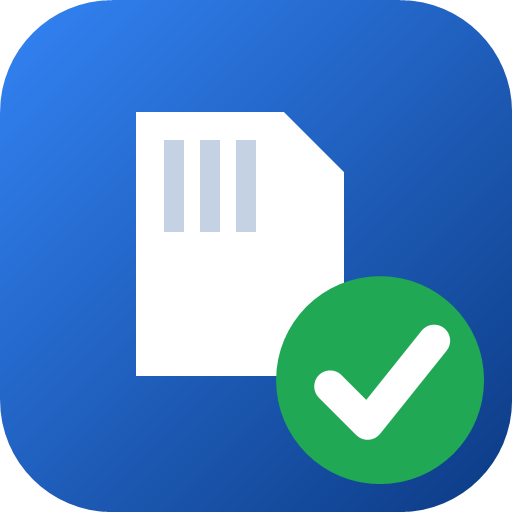
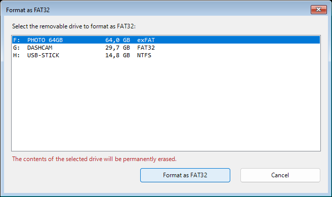
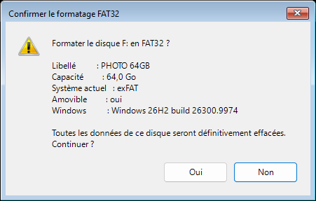
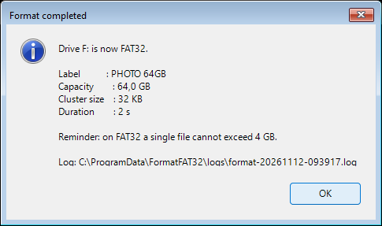

# FormatFAT32 — « Formater en FAT32 » dans le menu contextuel des disques

Ajoute une action **Formater en FAT32** au clic droit des disques dans l'Explorateur.
Elle effectue un **formatage rapide en FAT32** des cartes SD et clés USB — y compris
celles de plus de 32 Go — après une boîte de confirmation et une élévation UAC.

Aucun binaire tiers : l'outil n'appelle que `format.com` de Microsoft.

**Interface en 7 langues** · **aucune fenêtre de console** · **un seul `Setup.exe`** · licence MIT

> ⚠️ **Action destructive.** Le formatage efface tout le contenu du volume ciblé.
> Vérifiez toujours la lettre et la capacité affichées dans la confirmation.

---

## Captures d'écran

| Sélection du disque (menu Démarrer) | Confirmation | Résultat |
|---|---|---|
|  |  |  |

L'interface suit la langue choisie à l'installation — 7 langues sont fournies
(français, anglais, allemand, espagnol, italien, portugais, néerlandais) :


## Fonctionnalités

- **Action de menu contextuel** sur les disques — `Drive\shell\FormatFAT32`, pour tous les
  utilisateurs ou pour l'utilisateur courant.
- **Disques amovibles uniquement.** Les disques fixes, réseau et optiques sont refusés ;
  le disque système est toujours refusé. L'entrée est visible sur tous les disques car
  le Shell n'offre pas de filtre fiable « amovible seulement », mais le script l'impose.
- **Un avant/après explicite.** La confirmation affiche le libellé, la capacité, le système
  de fichiers actuel, le caractère amovible et la version de Windows détectée.
- **Vérifié, pas supposé.** Après `format.com`, le volume est relu jusqu'à ce qu'il déclare
  FAT32 — le code retour seul n'est pas pris pour preuve.
- **Aucune fenêtre de console.** Le verbe Shell lance `wscript.exe` → un lanceur `.vbs` →
  PowerShell masqué. Seuls l'invite UAC et les boîtes de l'outil apparaissent.
- **Dialogues et boutons traduits.** Les textes sont dans `lang\*.psd1` ; les boutons sont
  dessinés par l'outil pour suivre la langue choisie, et non celle de Windows.
- **Contrôle de version Windows.** Créer du FAT32 au-delà de 32 Go exige une build récente ;
  l'outil le vérifie *avant* de formater et le dit clairement (`-SkipVersionCheck` pour
  passer outre).
- **Journalisation.** `%ProgramData%\FormatFAT32\logs` (administrateur) ou
  `%LOCALAPPDATA%\FormatFAT32\logs` (compte standard), en anglais pour le support.

## Configuration requise

| Cas d'usage | Version minimale |
|---|---|
| FAT32 jusqu'à **32 Go** | Tout Windows avec **PowerShell 5.1** (Windows 10 / 11) |
| FAT32 **au-delà de 32 Go** | **Windows 11 24H2 build 26100.8313** ou **25H2 build 26200.8313** (ou ultérieure) |
| Dans tous les cas | Droits administrateur (demandés par le setup ou par UAC au formatage) |

**Pourquoi cette contrainte.** Le plafond de 32 Go est une politique du formateur Windows,
pas une limite du système FAT32 (le format accepte ~2 To). Microsoft l'a levé **en ligne de
commande uniquement**, à partir des builds ci-dessus. Sur une build plus ancienne,
`format.com` répond « The volume is too big for FAT32 ». L'outil contrôle donc
`CurrentBuildNumber`/`UBR` et s'arrête avec un message explicite plutôt qu'un échec obscur.

Vérifiez votre build avec `winver`, ou lancez `-SelfTest`, qui l'affiche.

Sur un Windows plus ancien : mettez Windows à jour, ou formatez la carte une fois avec un
outil externe (Rufus avec l'option *Large FAT32*, ou `fat32format` de Ridgecrop, GPL-2.0 —
**non fourni ici**, car c'est un binaire tiers). Windows lit et écrit ensuite ce volume
FAT32 sans difficulté ; seule sa *création* exige une build récente.

## Installation

### Recommandé : le programme d'installation

Téléchargez `FormatFAT32-1.2.1-setup.exe` depuis les
[Releases](https://github.com/jbromanet69/FormatFAT32/releases) et exécutez-le.

- Le setup existe en **7 langues** ; la langue choisie devient celle de l'application.
- Installation dans `C:\Program Files\FormatFAT32`, entrée de menu contextuel pour tous
  les utilisateurs, raccourci dans le menu Démarrer et entrée standard dans
  *Applications et fonctionnalités*.
- Lancé sans élévation, le setup propose **« Installer pour moi uniquement »**
  (sans UAC, enregistrement par utilisateur sous `HKCU\Software\Classes`).
- La mise à jour depuis l'ancien installateur PowerShell supprime automatiquement ses restes.

Déploiement silencieux / scripté :

```bat
FormatFAT32-1.2.1-setup.exe /VERYSILENT /SUPPRESSMSGBOXES /NORESTART
FormatFAT32-1.2.1-setup.exe /VERYSILENT /CURRENTUSER /LANG=fr /SUPPRESSMSGBOXES
```

### Alternative : l'installateur PowerShell

Pour un déploiement portable ou par utilisateur sans le setup :

```powershell
powershell -ExecutionPolicy Bypass -File .\Install-FormatFAT32.ps1
powershell -ExecutionPolicy Bypass -File .\Install-FormatFAT32.ps1 -Hive HKCU -Language fr
```

| Paramètre | Défaut | Rôle |
|---|---|---|
| `-Hive` | `HKLM` | `HKLM` (tous les utilisateurs) ou `HKCU` (utilisateur courant) |
| `-InstallDir` | `%ProgramFiles%\FormatFAT32` | Dossier d'installation |
| `-Language` | langue de Windows | Langue de l'interface (`en fr de es it pt nl`) |
| `-Publisher` | *(aucun)* | Éditeur affiché dans Applications et fonctionnalités |
| `-NoShortcut` | désactivé | Pas de raccourci dans le menu Démarrer |
| `-Quiet` | désactivé | Sortie minimale |

L'installateur termine par une liste de contrôles (`[OK]`) et indique si la build de
Windows prend en charge le FAT32 au-delà de 32 Go.

### Archive portable (ZIP)

`Build-Package.ps1` produit `dist\FormatFAT32-<version>-portable.zip` avec les scripts, les
7 fichiers de langue, le lanceur et la documentation — pour les collègues qui préfèrent un
dossier à dézipper puis installer avec `Install-FormatFAT32.ps1`.

## Utilisation

- **Clic droit sur un disque dans l'Explorateur** → *Formater en FAT32*.
  Sur Windows 11, l'entrée se trouve dans **Afficher plus d'options** (`Maj+F10`).
- Ou **menu Démarrer → Formater en FAT32** pour ouvrir le sélecteur de disques.

Rien d'autre n'apparaît à l'écran : ni console, ni fenêtre PowerShell, seulement l'invite
UAC (si l'élévation est nécessaire) et les boîtes de confirmation / résultat.

### Ligne de commande

```powershell
.\Format-RemovableFat32.ps1 -Drive E:                     # formate E: après confirmation
.\Format-RemovableFat32.ps1 -Drive E: -DryRun             # affiche le plan, ne change rien
.\Format-RemovableFat32.ps1                               # sélection dans une fenêtre
.\Format-RemovableFat32.ps1 -Drive E: -Label PHOTOS -ClusterSizeKb 32
.\Format-RemovableFat32.ps1 -Drive E: -Yes -Language de   # sans confirmation, en allemand
.\Format-RemovableFat32.ps1 -Drive E: -AllowFixed         # lecteurs de cartes déclarés « Fixe »
```

| Paramètre | Rôle |
|---|---|
| `-Drive` | Lettre du lecteur (`E`, `E:`, `E:\`). Omis → fenêtre de sélection |
| `-Label` | Nouveau libellé du volume (11 caractères max) |
| `-ClusterSizeKb` | Taille de cluster en Ko (défaut : Windows) |
| `-Language` | Langue de l'interface : `en fr de es it pt nl` |
| `-AllowFixed` | Autorise les disques déclarés *Fixe* (certains lecteurs de cartes) |
| `-Yes` | Supprime la boîte de confirmation |
| `-DryRun` | Affiche le plan d'action sans rien modifier |
| `-SelfTest` | Contrôle script + WinForms + affiche la build Windows, puis quitte |
| `-SkipVersionCheck` | Ignore le contrôle de build pour le FAT32 > 32 Go |

Codes de retour : `0` succès · `1` erreur · `2` annulé par l'utilisateur ·
`3` échec du formatage · `4` élévation refusée.

## Limites à connaître

- **4 Go maximum par fichier** — limite du système FAT32, pas de l'outil.
- **2 To maximum par volume**.
- Les cartes de plus de 32 Go sont officiellement des **SDXC**, dont le système de
  référence est **exFAT**. Le FAT32 fonctionne, mais certains appareils (appareils photo,
  dashcams, imprimantes, autoradios) peuvent refuser la carte ou la reformater. Utilisez
  FAT32 quand l'appareil l'exige.
- Certains lecteurs de cartes déclarent les cartes SD comme **Fixe** et non Amovible ;
  utilisez `-AllowFixed` en ligne de commande dans ce cas.
- Seuls les lecteurs ayant une lettre et un volume monté sont traités.

## Compiler depuis les sources

```powershell
# Icône de l'application + logo des README (GDI+, sans dépendance)
powershell -ExecutionPolicy Bypass -File .\tools\New-Icon.ps1

# Installateur (Inno Setup 6 requis : https://jrsoftware.org/isdl.php)
& "C:\Program Files (x86)\Inno Setup 6\ISCC.exe" .\installer\FormatFAT32.iss
# -> dist\FormatFAT32-<version>-setup.exe
```

## Arborescence du dépôt

```
FormatFAT32/
├─ Format-RemovableFat32.ps1    # moteur : validation, dialogues, formatage, vérification, journal
├─ Launch-FormatFAT32.vbs       # lanceur sans console (wscript -> PowerShell masqué)
├─ Install-FormatFAT32.ps1      # installateur alternatif (HKLM/HKCU, sans setup)
├─ Uninstall-FormatFAT32.ps1    # son désinstalleur
├─ lang\                        # textes de l'interface : en fr de es it pt nl
├─ installer\FormatFAT32.iss    # script Inno Setup de l'installateur .exe
├─ Build-Package.ps1            # construit l'archive ZIP portable (scripts + langues)
├─ tools\New-Icon.ps1           # génère FormatFAT32.ico et docs\logo.png
├─ docs\                        # captures d'écran et logo utilisés par les README
├─ .github\workflows\           # lint + compilation de l'installateur
├─ CHANGELOG.md                 # historique des versions
└─ LICENSE
```

## Dépannage

| Symptôme | À vérifier |
|---|---|
| Rien ne se passe au clic | Consultez `%ProgramData%\FormatFAT32\logs` (ou `%LOCALAPPDATA%`). |
| « Ce PC ne peut pas créer un volume FAT32 de plus de 32 Go » | Build Windows trop ancienne — voir [Configuration requise](#configuration-requise). |
| « Échec du formatage » | Carte protégée en écriture, occupée ou défectueuse — le dialogue affiche la sortie de `format.com`. |
| Entrée absente sous Windows 11 | Elle est dans *Afficher plus d'options* (`Maj+F10`). Vérifiez `HKLM\SOFTWARE\Classes\Drive\shell\FormatFAT32`. |
| « est de type « Fixe » et non « Amovible » » | Lecteur de cartes déclaré Fixe → utilisez `-AllowFixed`. |
| Dialogues dans une autre langue | Vérifiez `<dossier d'installation>\language.txt`, ou passez `-Language`. |

## Licence

MIT — voir [LICENSE](./LICENSE).

Projet non affilié à Microsoft. « Windows » et « Microsoft » sont des marques de Microsoft
Corporation. `format.com` fait partie de Windows et est utilisé tel quel : rien n'est
redistribué ni re-licencié ici. Le script Inno Setup fourni ne sert qu'à fabriquer un
installateur ; Inno Setup lui-même n'est pas redistribué.

---

🇬🇧 [English version](./README.md)
