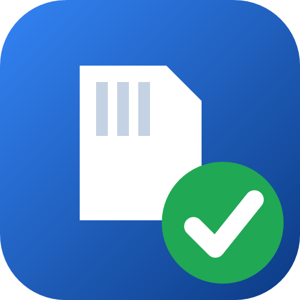
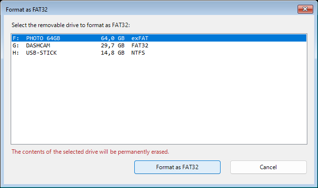
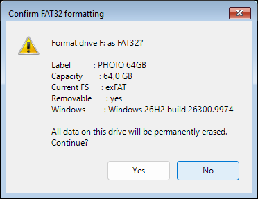
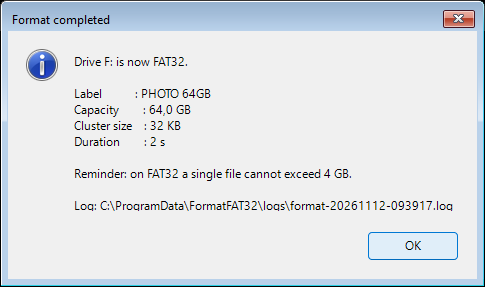
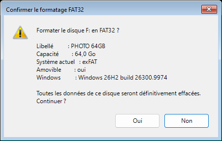

# FormatFAT32 — right-click “Format as FAT32” for removable drives

Adds a **Format as FAT32** action to the right-click menu of drives in File Explorer.
It performs a **quick format to FAT32** on SD cards and USB drives — including cards
larger than 32 GB — after a confirmation dialog and a UAC prompt.

No third-party binary: the tool only calls Microsoft's `format.com`.

**UI in 7 languages** · **no console window** · **single `Setup.exe`** · MIT licence

> ⚠️ **Destructive action.** Formatting erases everything on the target volume.
> Always check the drive letter and the capacity shown in the confirmation dialog.

---

## Screenshots

| Drive picker (Start menu) | Confirmation | Result |
|---|---|---|
|  |  |  |

The interface follows the language chosen during setup — 7 languages ship with the tool
(English, French, German, Spanish, Italian, Portuguese, Dutch):



## Features

- **Context-menu action** on drives — `Drive\shell\FormatFAT32`, machine-wide or per-user.
- **Removable drives only.** Fixed, network and optical drives are refused; the system
  drive is always refused. The entry is visible on every drive because the Shell has no
  reliable “removable only” filter, but the script enforces it.
- **Explicit before/after.** The confirmation shows label, capacity, current file system,
  whether the drive is removable, and the detected Windows build.
- **Verified, not assumed.** After `format.com`, the volume is re-read until it reports
  FAT32 — the exit code alone is not trusted.
- **No console window at all.** The shell verb launches `wscript.exe` → a `.vbs` shim →
  PowerShell hidden. You only see the UAC prompt and the tool's own dialogs.
- **Localised dialogs and buttons.** Strings live in `lang\*.psd1`; buttons are drawn by
  the tool so they follow the selected language, not the Windows display language.
- **Windows build gate.** Creating FAT32 above 32 GB needs a recent build; the tool checks
  it *before* formatting and says so plainly (`-SkipVersionCheck` to bypass).
- **Logging.** `%ProgramData%\FormatFAT32\logs` (administrator) or
  `%LOCALAPPDATA%\FormatFAT32\logs` (standard user), English-only for support.

## Requirements

| Scenario | Minimum version |
|---|---|
| FAT32 up to **32 GB** | Any Windows with **PowerShell 5.1** (Windows 10 / 11) |
| FAT32 **above 32 GB** | **Windows 11 24H2 build 26100.8313** or **25H2 build 26200.8313** (or later) |
| Everything | Administrator rights (requested by the setup, or by UAC at format time) |

**Why the version matters.** The 32 GB cap is a Windows formatter policy, not a FAT32
limit (the format supports ~2 TB). Microsoft lifted it **for the command line only**,
starting with the builds above. On an older build, `format.com` answers “The volume is
too big for FAT32”. The tool therefore checks `CurrentBuildNumber`/`UBR` and stops with an
explicit message instead of a cryptic failure.

Check your build with `winver`, or run `-SelfTest`, which prints it.

On an older Windows: update Windows, or format the card once with an external tool
(Rufus with *Large FAT32*, or Ridgecrop's `fat32format`, GPL-2.0 — **not bundled here**,
because it is a third-party binary). Windows reads and writes such a FAT32 volume without
any problem; only *creating* it needs a recent build.

## Install

### Recommended: the setup program

Download `FormatFAT32-1.2.1-setup.exe` from
[Releases](https://github.com/jbromanet69/FormatFAT32/releases) and run it.

- Setup is available in **7 languages**; the chosen language becomes the app language.
- Installs to `C:\Program Files\FormatFAT32`, registers the context-menu entry for all
  users, adds a Start menu shortcut, and creates a standard *Apps & features* entry.
- Launching the setup from a non-elevated context offers **“Install for me only”**
  (no UAC, per-user registration under `HKCU\Software\Classes`).
- Upgrading from the legacy PowerShell installer removes its leftovers automatically.

Silent / scripted deployment:

```bat
FormatFAT32-1.2.1-setup.exe /VERYSILENT /SUPPRESSMSGBOXES /NORESTART
FormatFAT32-1.2.1-setup.exe /VERYSILENT /CURRENTUSER /LANG=de /SUPPRESSMSGBOXES
```

### Alternative: the PowerShell installer

For portable or scripted per-user deployment without the setup:

```powershell
powershell -ExecutionPolicy Bypass -File .\Install-FormatFAT32.ps1
powershell -ExecutionPolicy Bypass -File .\Install-FormatFAT32.ps1 -Hive HKCU -Language en
```

| Parameter | Default | Purpose |
|---|---|---|
| `-Hive` | `HKLM` | `HKLM` (all users) or `HKCU` (current user) |
| `-InstallDir` | `%ProgramFiles%\FormatFAT32` | Target folder |
| `-Language` | Windows UI language | UI language (`en fr de es it pt nl`) |
| `-Publisher` | *(none)* | Publisher shown in Apps & features |
| `-NoShortcut` | off | Skip the Start menu shortcut |
| `-Quiet` | off | Minimal output |

The installer ends with a checklist (`[OK]` lines) and states whether this Windows build
supports FAT32 above 32 GB.

### Portable ZIP

`Build-Package.ps1` builds `dist\FormatFAT32-<version>-portable.zip` containing the
scripts, the 7 language files, the launcher and the documentation — for colleagues who
prefer a folder they can unzip and install with `Install-FormatFAT32.ps1`.

## Usage

- **Right-click a drive in File Explorer** → *Format as FAT32*.
  On Windows 11 the entry lives under **Show more options** (`Shift+F10`).
- Or **Start menu → Format as FAT32** to open the drive picker.

Nothing else appears on screen: no console window, no PowerShell window, only the UAC
prompt (when elevation is needed) and the confirmation / result dialogs.

### Command line

```powershell
.\Format-RemovableFat32.ps1 -Drive E:                     # format E: after confirmation
.\Format-RemovableFat32.ps1 -Drive E: -DryRun             # show the plan, change nothing
.\Format-RemovableFat32.ps1                               # pick a drive in a window
.\Format-RemovableFat32.ps1 -Drive E: -Label PHOTOS -ClusterSizeKb 32
.\Format-RemovableFat32.ps1 -Drive E: -Yes -Language de   # no confirmation, German UI
.\Format-RemovableFat32.ps1 -Drive E: -AllowFixed         # card readers that report "Fixed"
```

| Parameter | Purpose |
|---|---|
| `-Drive` | Drive letter (`E`, `E:`, `E:\`). Omitted → picker window |
| `-Label` | New volume label (11 characters max) |
| `-ClusterSizeKb` | Cluster size in KB (Windows default if omitted) |
| `-Language` | UI language: `en fr de es it pt nl` |
| `-AllowFixed` | Also allow drives reported as *Fixed* (some card readers) |
| `-Yes` | Skip the confirmation dialog |
| `-DryRun` | Print the action plan, change nothing |
| `-SelfTest` | Check script + WinForms + report the Windows build, then exit |
| `-SkipVersionCheck` | Ignore the build check for FAT32 > 32 GB |

Exit codes: `0` success · `1` error · `2` cancelled by user · `3` formatting failed ·
`4` elevation denied.

## Limits to know

- **4 GB maximum per file** — a FAT32 file system limit, not a tool limit.
- **2 TB maximum per volume**.
- SD cards above 32 GB are officially **SDXC**, whose reference file system is **exFAT**.
  FAT32 works, but some devices (cameras, dashcams, printers, car stereos) may refuse the
  card or reformat it. Use FAT32 when the device requires it.
- Some card readers report SD cards as **Fixed** rather than Removable; use `-AllowFixed`
  from the command line for those.
- Only drives with a drive letter and a mounted volume are handled.

## Build from source

```powershell
# Application icon + README logo (GDI+, no dependency)
powershell -ExecutionPolicy Bypass -File .\tools\New-Icon.ps1

# Installer (Inno Setup 6 required: https://jrsoftware.org/isdl.php)
& "C:\Program Files (x86)\Inno Setup 6\ISCC.exe" .\installer\FormatFAT32.iss
# -> dist\FormatFAT32-<version>-setup.exe
```

## Repository layout

```
FormatFAT32/
├─ Format-RemovableFat32.ps1    # formatting engine: validation, dialogs, format, verify, log
├─ Launch-FormatFAT32.vbs       # console-less launcher (wscript -> PowerShell hidden)
├─ Install-FormatFAT32.ps1      # alternative installer (HKLM/HKCU, no setup program)
├─ Uninstall-FormatFAT32.ps1    # its uninstaller
├─ lang\                        # UI strings: en fr de es it pt nl
├─ installer\FormatFAT32.iss    # Inno Setup script for the .exe installer
├─ Build-Package.ps1            # builds the portable ZIP (scripts + languages)
├─ tools\New-Icon.ps1           # generates FormatFAT32.ico and docs\logo.png
├─ docs\                        # screenshots and logo used by the READMEs
├─ .github\workflows\           # lint + installer build
├─ CHANGELOG.md                 # release history
└─ LICENSE
```

## Troubleshooting

| Symptom | What to check |
|---|---|
| Nothing happens on click | See `%ProgramData%\FormatFAT32\logs` (or `%LOCALAPPDATA%`). |
| “This PC cannot create a FAT32 volume larger than 32 GB” | Windows build too old — see [Requirements](#requirements). |
| “Formatting failed” | Card write-protected, busy, defective — the dialog shows `format.com` output. |
| Entry missing on Windows 11 | It is under *Show more options* (`Shift+F10`). Verify `HKLM\SOFTWARE\Classes\Drive\shell\FormatFAT32`. |
| “is of type « Fixed », not « Removable »” | Card reader reports Fixed → use `-AllowFixed`. |
| Dialogs in a language you did not choose | Check `<install dir>\language.txt`, or pass `-Language`. |

## License

MIT — see [LICENSE](./LICENSE).

Not affiliated with Microsoft. “Windows” and “Microsoft” are trademarks of Microsoft
Corporation. `format.com` is part of Windows and is used as-is; nothing is redistributed
or re-licensed here. The bundled Inno Setup script only builds an installer; Inno Setup
itself is not redistributed.

---

🇫🇷 [Version française](./README.fr.md)
